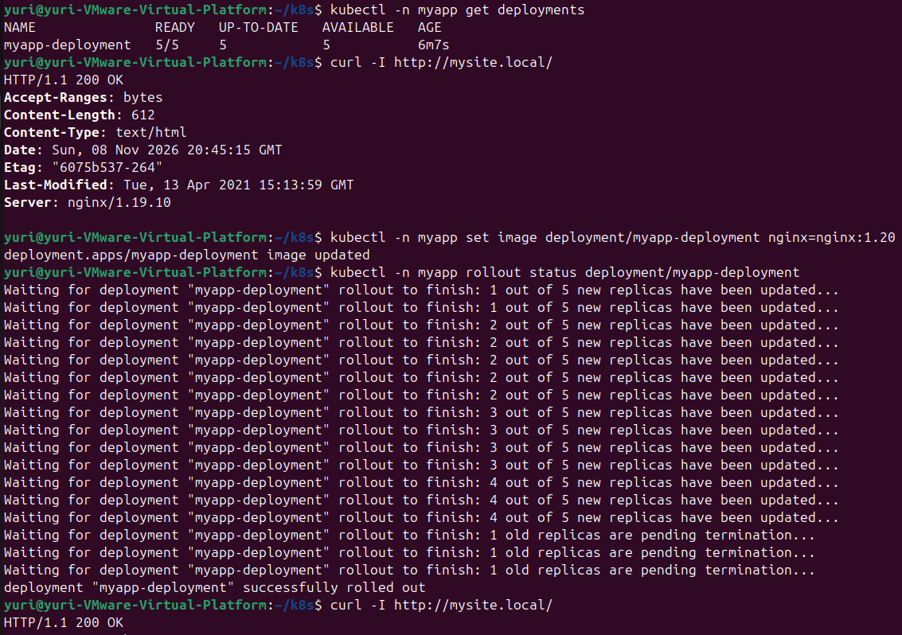
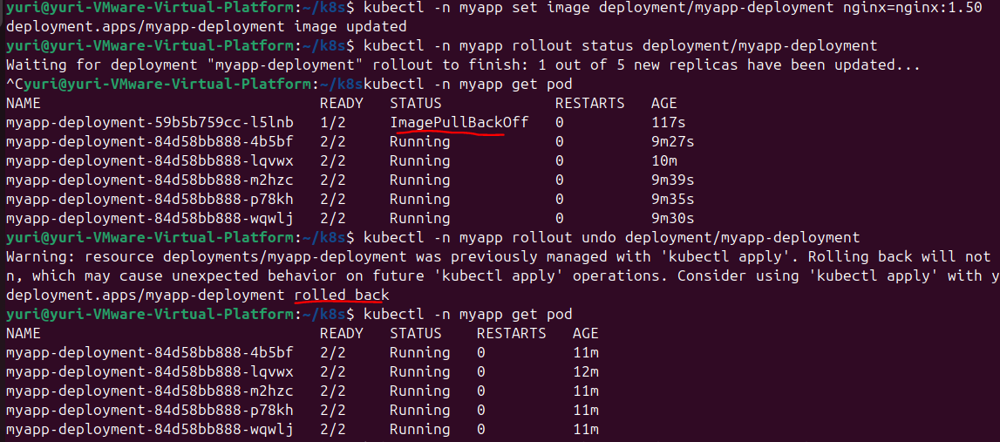

# «Обновление приложений»

### Цель задания

В этом задании вам предстоит выбрать и настроить стратегию обновления приложения.

------

### Задание 1. Выбрать стратегию обновления приложения и описать ваш выбор

1. Имеется приложение, состоящее из нескольких реплик, которое требуется обновить.
2. Ресурсы, выделенные для приложения, ограничены, и нет возможности их увеличить.
3. Запас по ресурсам в менее загруженный момент времени составляет 20%.
4. Обновление мажорное, новые версии приложения не умеют работать со старыми.
5. Вам нужно объяснить свой выбор стратегии обновления приложения.

Стратегии Blue-green, Canary не подходят из-за ограничения ресурсов.
Rolling-Update не подходят из-за сосуществования разных несовместимых версий приложения.
Поэтому остается Recreate. Но его нужно провдить в часы минимальной загрузки.
------

### Задание 2. Обновить приложение

1. Создать Deployment приложения с контейнерами nginx и multitool (образ wbitt/network-multitool). Версию nginx взять 1.19. Количество реплик — 5.
2. Для multitool задайте HTTP_PORT и HTTPS_PORT, отличные от портов nginx, чтобы избежать конфликта.
3. Обновить версию nginx в приложении до версии 1.20, сократив время обновления до минимума. Приложение должно быть доступно.
4. Попытаться обновить nginx до заведомо несуществующей версии (например, 1.50); приложение должно оставаться доступным.
5. Откатиться после неудачного обновления.

------