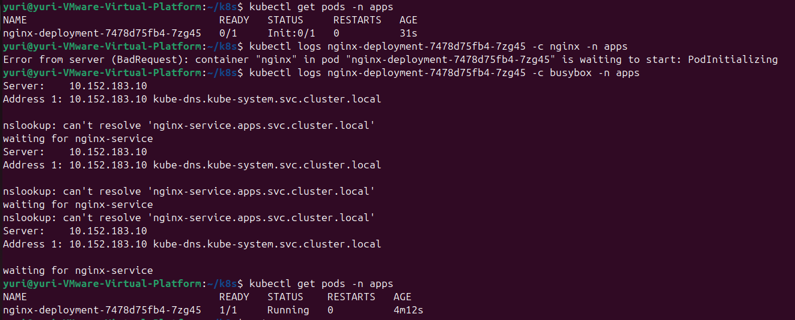

# «Обновление приложений»

### Цель задания

В этом задании вам предстоит выбрать и настроить стратегию обновления приложения.

------

### Задание 1. Выбрать стратегию обновления приложения и описать ваш выбор

1. Имеется приложение, состоящее из нескольких реплик, которое требуется обновить.
2. Ресурсы, выделенные для приложения, ограничены, и нет возможности их увеличить.
3. Запас по ресурсам в менее загруженный момент времени составляет 20%.
4. Обновление мажорное, новые версии приложения не умеют работать со старыми.
5. Вам нужно объяснить свой выбор стратегии обновления приложения.

Стратегии Blue-green, Canary не подходят из-за ограничения ресурсов.
Rolling-Update не подходят из-за сосуществования разных несовместимых версий приложения.
Поэтому остается Recreate. Но его нужно провдить в часы минимальной загрузки.
------

### Задание 2. Создать Deployment и обеспечить старт основного контейнера при выполнении условий

1. Создать Deployment приложения nginx и обеспечить старт контейнера только после того, как будет запущен сервис этого приложения.
2. Убедиться, что nginx не стартует. В качестве Init-контейнера взять busybox.
```
apiVersion: apps/v1
kind: Deployment
metadata: 
  name: nginx-deployment
  labels:
    app: nginx
spec:
  replicas: 1
  selector:
    matchLabels:
      app: nginx
  template:
    metadata:
      labels:
        app: nginx
    spec:
      containers:
      - name: nginx
        image: nginx:1.14.2
        ports:
        - containerPort: 80
      initContainers:
      - name: busybox
        image: busybox:1.28
        command: ['sh', '-c', 'until nslookup nginx-service.apps.svc.cluster.local; do echo waiting for nginx-service; sleep 2; done']
```

3. Создать и запустить Service. Убедиться, что Init запустился.
```
apiVersion: v1
kind: Service
metadata:
  name: nginx-service
spec:
  selector:
    app: nginx
  ports:
  - name: http
    protocol: TCP
    port: 80
```

4. Продемонстрировать состояние пода до и после запуска сервиса.


------

### Правила приема работы

1. Домашняя работа оформляется в своем Git-репозитории в файле README.md. Выполненное домашнее задание пришлите ссылкой на .md-файл в вашем репозитории.
2. Файл README.md должен содержать скриншоты вывода необходимых команд `kubectl` и скриншоты результатов.
3. Репозиторий должен содержать файлы манифестов и ссылки на них в файле README.md.

------